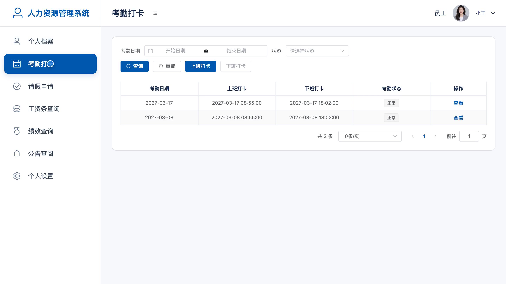
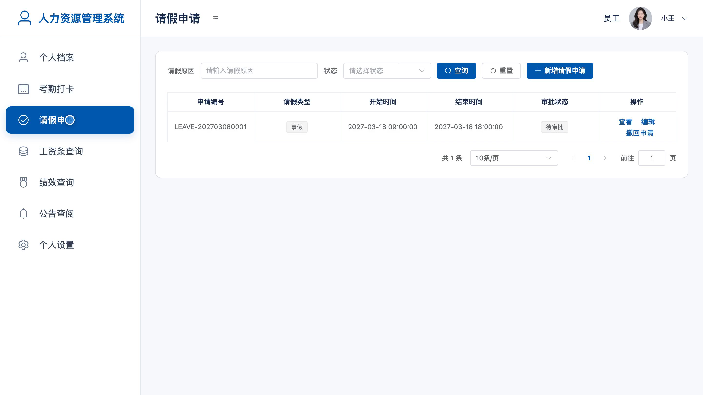
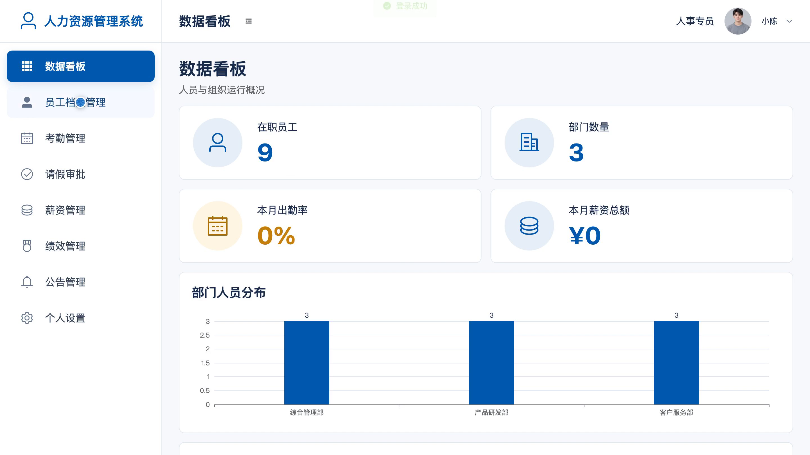
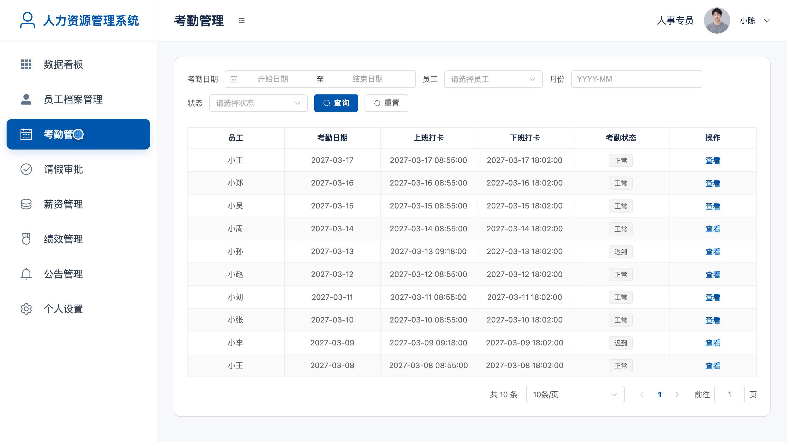
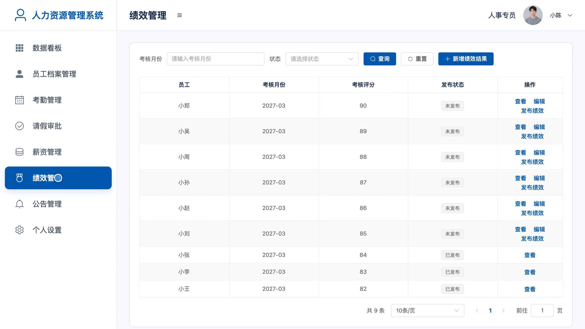
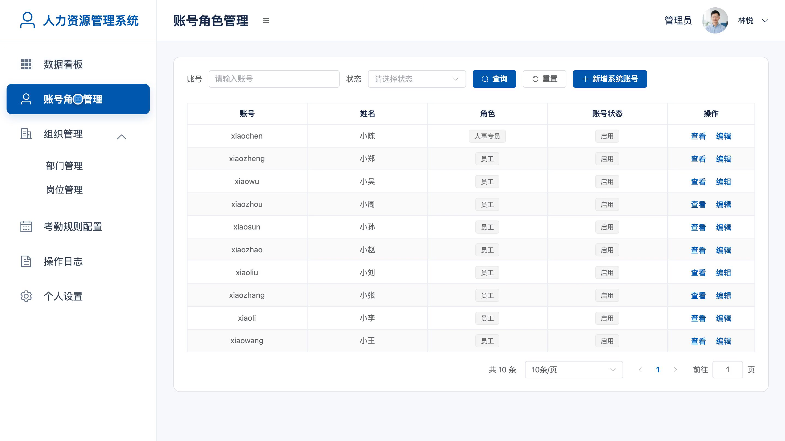
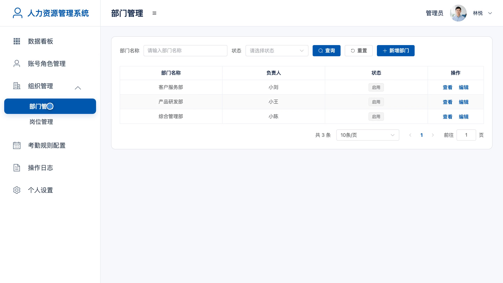

# bs145A
bs145A人力资源管理系统源码 Java SpringBoot3 Vue3 前后分离
## 源码问题查看主页咨询

### 一、关键词
人力资源管理、员工档案、考勤打卡、请假审批、薪资绩效

### 二、作品包含
源码+数据库+全套环境和工具资源+本地部署教程

### 三、项目技术
前端技术： Html、Css、Js、Vue3.4、Element-Plus
后端技术：Java、SpringBoot3.2.0、MyBatis-Plus

### 四、运行环境要求
开发工具：IDEA/eclipse + VSCODE

数据库：MySQL5.7（共12张表）

数据库管理工具：Navicat10以上版本

环境配置软件： JDK17 + Maven3.6

前端Nodejs：18

浏览器：谷歌浏览器

### 五、项目介绍
项目编号：bs145A

人力资源管理系统面向员工、人事专员和管理员，支持员工档案、考勤请假、薪资绩效及组织账号管理，按角色提供日常查询、业务办理和管理操作。

角色：员工、人事专员、管理员

员工功能：个人档案查看与联系方式维护、上下班考勤打卡与记录查询、请假申请与审批结果查询、工资条及收支明细查询、月度绩效结果查询、人事公告查阅、头像与登录密码维护。

人事专员功能：员工档案管理、考勤记录核对、请假审批与意见记录、月度薪资核对与工资条发布、绩效评分录入与发布、人事公告发布与下架、人事数据看板、头像与登录密码维护。

管理员功能：员工与人事账号角色管理、部门与岗位管理、考勤规则配置、人员与组织数据看板、关键操作日志查询、头像与登录密码维护。

### 六、运行截图

